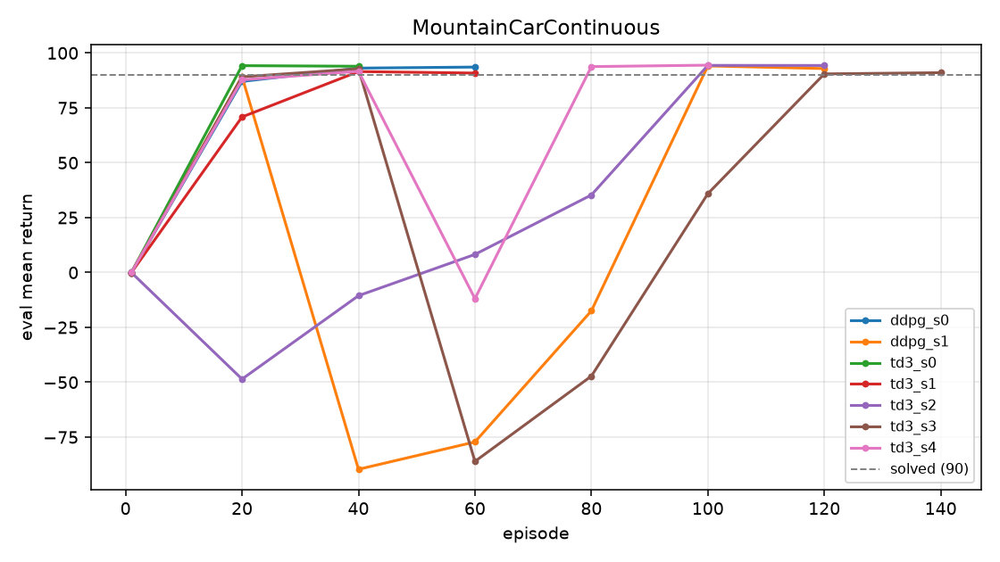

# RL_MountainCarContinuous

用 DDPG / TD3 求解 `MountainCarContinuous-v0` 的可复现实现。

**实测：TD3 五个随机种子全部达标，5/5 达到官方 solved 判据（mean return > 90），中位数 100 个 episode。**
单次训练在 RTX 5070 Ti 上约 1–3 分钟。



---

## 实测结果

环境：Python 3.13.16 / torch 2.11.0+cu128 / gymnasium 1.4.0 / numpy 2.5.4，
GPU 为 RTX 5070 Ti Laptop（12 GB，sm_120），驱动 621.01。

| 算法 | 种子数 | 达标 | 收敛 episode（mean±std） | 中位数 | 最终 mean return |
|---|---|---|---|---|---|
| TD3 | 5 | **5/5** | 92 ± 37 | 100 | 92.89 ± 1.65 |
| DDPG | 2 | 2/2 | 90 ± 30 | 90 | 93.24 ± 0.36 |

逐次运行明细：

| run | 算法 | episode | 总步数 | 最终 return | 成功率 | 耗时 |
|---|---|---|---|---|---|---|
| td3_s0 | TD3 | 40 | 13585 | 93.90 | 100% | 78 s |
| td3_s1 | TD3 | 60 | 18622 | 90.86 | 100% | 113 s |
| td3_s2 | TD3 | 120 | 72579 | 94.35 | 100% | 451 s |
| td3_s3 | TD3 | 140 | 55736 | 90.89 | 100% | 357 s |
| td3_s4 | TD3 | 100 | 31587 | 94.44 | 100% | 165 s |
| ddpg_s0 | DDPG | 60 | 14436 | 93.60 | 100% | 91 s |
| ddpg_s1 | DDPG | 120 | 54859 | 92.87 | 100% | 356 s |

> 耗时是在**两组实验并行**跑、共用一张卡的情况下测的，比单独跑偏慢；不影响结果本身。

### 结论：真正起作用的是工程修正，而不是换算法

这是这次重构最值得记下来的一点。原本预期是「DDPG 在 MCC 上很难收敛，换 TD3 才能解决」，
但**DDPG 两个种子也都收敛了**，样本效率（90 vs 92 个 episode）与 TD3 没有可辨差异。

真正把训练从「1 万个 episode 也不保证」变成「100 个 episode 稳定达标」的，是这几项：

1. **终止掩码 + 区分 truncation** —— 终点 +100 不再渗回所有状态
2. **观测归一化** —— 速度信号不再被位置淹没
3. **不衰减的高斯噪声** —— 摆动策略需要的探索没有被提前关掉
4. **Actor 输出层小初始化** —— 初始动作 ≈ 0，策略有机会先学会「荡一下」
5. **奖励缩放** —— +100 的稀疏奖励压到 Q 网络舒服的区间

TD3 那三个机制（双 Q、目标平滑、延迟更新）在这个任务上没有体现出可测的优势。
保留它更多是为了对照与扩展，不是因为它"更正确"。

需要诚实说明：两个算法都出现过**中途崩溃再恢复**的情况
（`ddpg_s1` 在 episode 40–70 掉到 −89.66，`td3_s3` 在 episode 60–90 掉到 −86.07），
说明剩余的方差不来自算法选择，而来自探索与 critic 稳定性。想进一步压低方差，
比换算法更有效的方向是：多环境并行采样、更大的 batch、或者把 critic 的更新频率降下来。

### 设备基准

这个任务的网络很小（2 维输入、256×256 MLP、batch 256），GPU 是否值得用需要实测：

| 设备 | 吞吐 | 每次更新 |
|---|---|---|
| CPU（单线程） | 161 updates/s | 6.23 ms |
| CUDA | **236 updates/s** | **4.24 ms** |

**GPU 快 1.47x**，所以默认用 GPU。但在你自己的机器上重跑一遍
`python tools/bench_device.py` 更靠谱——差距会随 CPU 单核性能大幅变化。

---

## 快速开始

```bash
python -m venv .venv
.venv\Scripts\activate            # Windows
# source .venv/bin/activate       # Linux / macOS

pip install -r requirements.txt
# GPU 版 torch 请按显卡架构单独装，见 requirements.txt 顶部的说明

python tests/test_smoke.py        # 秒级自检
python train.py                   # 默认 TD3，seed 0
python eval.py --ckpt runs/td3_s0/policy.pt --episodes 20
python tools/plot_results.py runs/td3_s*/train.csv
python tools/collect_results.py   # 汇总所有运行成一张表
```

跑 DDPG 基线：

```bash
python train.py --algo ddpg --tag ddpg_baseline
```

多随机种子（PowerShell）：

```powershell
foreach ($s in 0..4) { python train.py --algo td3 --seed $s --tag "td3_s$s" }
```

中断后续训：

```bash
python train.py --resume runs/td3_s0/last_state.pt
```

> 环境依赖：`gymnasium` 或 `gym 0.23` 二选一，`rl/envs.py` 自动探测并统一
> `step()` 的四/五元组差异，两种后端都能跑。实测用的是 gymnasium 1.4.0。

---

## 目录结构

```
rl/
  config.py        所有超参数（dataclass，可序列化进 checkpoint）
  envs.py          gym/gymnasium 兼容层 + 观测归一化 + 动作边界
  normalizer.py    RunningMeanStd
  networks.py      Actor / Critic / TwinCritic（He 初始化 + 小初始化输出层）
  buffers.py       预分配 ndarray 的 ReplayBuffer
  noise.py         高斯噪声（默认）/ OU 噪声（消融用）
  logger.py        CSV 日志
  utils.py         种子、软更新、checkpoint
  algos/
    base.py        动作选择、经验存储、目标网络、存档
    ddpg.py        基线
    td3.py         主算法
train.py           训练入口（唯一 CLI）
eval.py            确定性评估
tools/plot_results.py      画学习曲线
tools/collect_results.py   汇总 runs/*/summary.pt
tools/bench_device.py      CPU vs GPU 吞吐基准
tests/test_smoke.py        秒级自检
results/                   学习曲线等产物
runs/                      每次运行的日志、checkpoint、summary
```

---

## 相比第一版改了什么

| # | 第一版的问题 | 现在 | 为什么重要 |
|---|---|---|---|
| 1 | `dones` 解包后从未使用，TD 目标缺少终止掩码 | `target = r + γ(1-d)·Q'`，且只在**真终止**时 `d=1` | 终点 +100 会通过 bootstrap 渗回所有状态 |
| 2 | `done` 无法区分终止与时间上限截断 | 显式区分 `terminated` / `truncated` | 截断当成终止会凭空截断价值 |
| 3 | `random.sample` + 每字段 `np.array` 重建 | 五个字段预分配 ndarray + 一次花式索引 | 采样开销降一个数量级 |
| 4 | `BUF_SIZE = 4096` | `100_000` | 小 buffer 样本相关性高、遗忘早期经验 |
| 5 | 观测未归一化（position ~1 vs velocity ~0.07） | wrapper 层归一化并 clip 到 ±5 | **实测最关键的改动之一** |
| 6 | OU 噪声 + 快速衰减到 1e-4 | 不衰减的独立高斯噪声（σ=0.15） | 极限环策略需要不相关探索 |
| 7 | Actor 输出饱和到 ±1 | 最后一层 3e-3 小初始化，初始动作 ≈ 0 | 给了策略「先荡一下」的机会 |
| 8 | `xavier_normal_` 配 ReLU | He/Kaiming + bias 置零 | 正确的方差缩放 |
| 9 | 目标网络未关梯度，前向无 `no_grad` | `requires_grad_(False)` + `torch.no_grad()` | 省显存与时间 |
| 10 | 每 10 episode 评估 100 episode | 每 20 episode 评估 10 episode，复用 env，固定种子 | 原方案评估开销可达训练的 10 倍 |
| 11 | 只在结束时存 actor | 周期 checkpoint + 中断保存 + `--resume` + 自包含 `policy.pt` | 中途崩了不用重来 |
| 12 | 无配置系统、无日志、无 CLI | dataclass + argparse + CSV + `summary.pt` | 实验可回溯 |
| 13 | 动作范围硬编码 [-1, 1] | 从 `action_space.low/high` 读 | 换环境不会静默出错 |
| 14 | `Buffer.__getitem__` 未满时越界 | 删除 | 死代码 |
| 15 | actor loss 的 backward 会给 critic 留梯度 | 显式 `critic.zero_grad(set_to_none=True)` 隔离 | 原来靠调用顺序侥幸正确 |
| 16 | 无依赖声明、无结果 | `requirements.txt` / `.gitignore` / CSV / 曲线 | 从「能跑」到「可信」 |

---

## 主要超参数

| 参数 | 默认 | 说明 |
|---|---|---|
| `--algo` | `td3` | `ddpg` 作基线 |
| `--episodes` | `300` | 达到目标会提前停 |
| `--lr` | `1e-3` | Adam |
| `--tau` | `0.005` | 目标网络软更新 |
| `--buffer-size` | `100000` | |
| `--batch-size` | `256` | |
| `--learning-starts` | `1000` | 预热步数 |
| `--reward-scale` | `0.1` | 只作用于 buffer，评估始终用原始奖励 |
| `--explore-sigma` | `0.15` | |
| `--policy-delay` | `2` | TD3 |
| `--eval-every` / `--eval-episodes` | `20` / `10` | |
| `--target-return` / `--patience` | `90` / `2` | 早停判据 |
| `--threads` | `1` | 小网络单线程有时更快，自己 benchmark |

---

## 常见问题

**训练很慢？** 先跑 `tools/bench_device.py` 确认该用 GPU 还是 CPU。另外降低评估频率
（`--eval-every 50`）。瓶颈通常在每步一次的梯度更新，而不在环境本身。

**收敛曲线中途掉下去？** 这是真实存在的现象，不是日志错误。`ddpg_s1` 和 `td3_s3`
都出现过掉到 −86 以下再爬回来的情况。当前配置设了 `--patience 2`，
要求连续两次评估达标才早停，就是为了避免把「偶然一次达标」当成收敛。

**想进一步压缩方差？** 比换算法更有效的方向：多环境并行采样、加大 batch、
降低 critic 更新频率（`--updates-per-step` 目前是 1）。

**import 报错说找不到 `rl`？** 请在仓库根目录运行。

**`--render` 报错？** 需要桌面环境；无头环境请去掉该参数。

---

## 致谢与来源

- TD3：[Fujimoto et al., 2018](https://arxiv.org/abs/1802.09477)
- DDPG：[Lillicrap et al., 2015](https://arxiv.org/abs/1509.02971)
- 第一版中的 OU 噪声实现取自 [rlkit](https://github.com/vitchyr/rlkit)（MIT）；
  本版保留于 `rl/noise.py` 仅用于消融，默认使用独立高斯噪声。

---

## 版本说明

仓库根目录的 `training.py` / `model.py` / `buffer.py` / `noise.py` 是**第一版教学实现**，
保留作对照，未做修改。

新代码全部在 `rl/` 目录下，入口是 `train.py` / `eval.py`。
